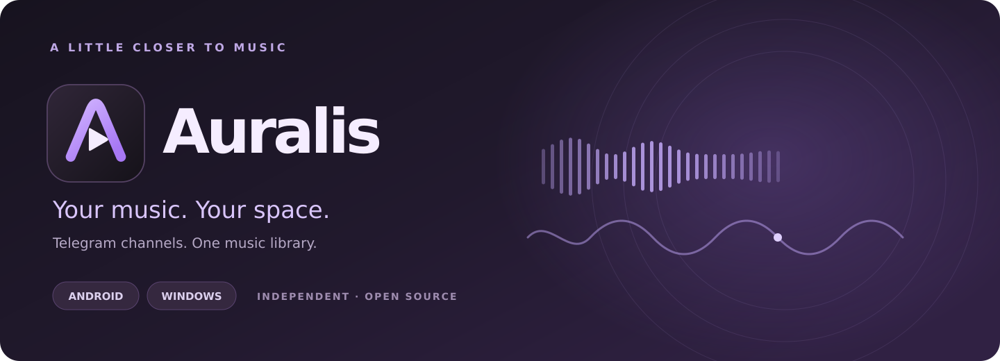
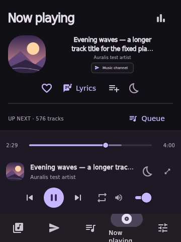
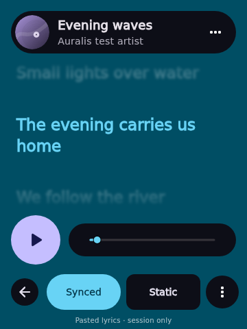
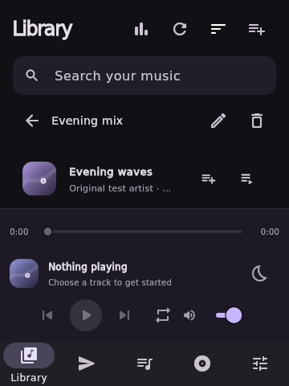

<div align="center">



**Your music. Your space.**

A compact music player for **Android and Windows**, built with Flutter.<br>
Bring music from your Telegram channels into one library, build playlists, and follow along with lyrics.

<p>
  <a href="https://github.com/SiamTest/Auralis/releases/latest"></a>
  <a href="https://github.com/SiamTest/Auralis"></a>
  <a href="LICENSE"></a>
  <br>
  <a href="https://flutter.dev"></a>
  <a href="https://dart.dev"></a>
  <a href="https://core.telegram.org/tdlib"></a>
</p>

[**Download Latest**](https://github.com/SiamTest/Auralis/releases/latest) · [**Setup Guide**](#get-started) · [**Report a Bug**](https://github.com/SiamTest/Auralis/issues) · [**Build from Source**](#development)

</div>

> [!TIP]
> **Use your own Telegram account and API credentials.** Select channels you already have access to, then open Library to browse their music together. Local music importing is not included.

---

## 🧭 Explore

- [Meet Auralis](#meet-auralis)
- [Features](#features)
- [Screenshots](#screenshots)
- [Get started](#get-started)
- [Library and collections](#library-and-collections)
- [Playback and lyrics](#playback-and-lyrics)
- [Stats, exports, and backups](#stats-exports-and-backups)
- [Settings and privacy](#settings-and-privacy)
- [Development](#development)
- [Publishing](#publishing)
- [Troubleshooting](#troubleshooting)
- [Project status](#project-status)
- [Developers](#developers)
- [License](#license)

---

<a id="meet-auralis"></a>

## ✨ Meet Auralis

Auralis brings music from your selected Telegram channels into a single, searchable library. Find a song, add it to your queue, save it to a playlist, or open the lyrics while it plays.

The charcoal and violet interface adapts from compact bottom navigation to a desktop sidebar. Album artwork, a wave seek bar, and a focused Now Playing view keep the music close without filling the screen with controls.

Playback uses **libmpv**, and Telegram connectivity uses **TDLib**. Auralis streams the original file bytes without re-encoding; the source file and your audio device determine the resulting quality.

---

<a id="features"></a>

## 💎 Your Music, in One Place

### 🎵 One Library from Your Channels

Select multiple Telegram channels, search by title, artist, or channel, and sort by post date, title, artist, or duration. Older audio posts load automatically, with progress and partial errors shown as the library grows.

### 💜 Favorites & Playlists

Keep favorites, create ordered playlists, and return to recently played music. Collections save locally between launches and can be included in a backup.

### 🎧 A Queue That Follows You

Add and reorder tracks, use Play next, shuffle upcoming songs, and repeat the queue or a single track. Seek, adjust volume, or set a sleep timer for a duration or the end of the song.

### 📝 Lyrics with the Music

Follow line-synced lyrics, click a line to seek, or read static lyrics. Read supported embedded tags, import an `.lrc` file, paste lyrics, or request a match from LRCLIB.

### 🖼️ Artwork Where It Belongs

See Telegram covers, channel avatars, and supported embedded MP3, FLAC, and M4A artwork. Covers load on demand; tracks without an available image use original procedural artwork.

### 📊 Listening Stats

View listening time, qualified plays, top tracks and artists, and seven-day activity. Export your stats as CSV or JSON.

### 💾 Backup & Restore

Back up stats, collections, selected channels, and preferences. Preview a restore before replacing saved data, with a local recovery copy kept for the previous state.

### Everyday details

- Responsive layouts for phones and desktop windows, with a reduced-motion preference.
- Android background playback with notification, lock-screen, and headset controls.
- Android audio interruption handling and pause on headphone removal.
- Windows focused media-key controls and volume adjustment with the mouse wheel.
- Windows update checks, checksum-verified downloads, and confirmed install/restart.
- Encrypted credential storage using Windows DPAPI or Android Keystore.

---

<a id="screenshots"></a>

## 🖼️ A Look Inside

<p align="center">
  
</p>

<table>
  <tr>
    <td align="center"><strong>Now Playing</strong></td>
    <td align="center"><strong>Lyrics</strong></td>
    <td align="center"><strong>Collections</strong></td>
  </tr>
  <tr>
    <td></td>
    <td></td>
    <td></td>
  </tr>
</table>

<p align="center"><sub>Automated Flutter test frames with synthetic tracks and original fixture artwork; these are not live Telegram account captures.</sub></p>

---

<a id="get-started"></a>

## 🚀 Get Started

### Download and install

Choose a matching asset from [the latest GitHub release](https://github.com/SiamTest/Auralis/releases/latest). If an Android asset is not attached yet, check the successful **Android APK build** run's artifacts.

| Platform | Package | Installation |
| --- | --- | --- |
| **Android 7.0+** | ARM64 APK | Open the APK to install on a compatible phone. x86_64 builds are also available for compatible devices or emulators; no 32-bit APK is provided. |
| **Windows x64** | `auralis-<version>-windows-x64-setup.exe` | Run the per-user installer. The Microsoft Visual C++ 2015–2022 x64 runtime is required. |
| **Windows portable** | Windows x64 release ZIP | Extract the complete package and launch `auralis.exe`; keep its DLLs and data folders together. |

Android assets marked **debug** are development builds. Consistent Android upgrade signing requires the same signing key; see [signing and upgrades](docs/ANDROID.md#signing-and-upgrades).

### First launch

1. Create your own application at [my.telegram.org](https://my.telegram.org) and obtain its **API ID** and **API hash**.
2. Open **Telegram** in Auralis and enter those credentials locally.
3. Sign in with your phone number, Telegram login code, and two-step verification password if requested.
4. Select one or more channels and choose **Open Library**.
5. Wait for the selected channels' audio posts to load, then choose a track to play.

Use **Load more** in Telegram to discover more accessible channels and **Refresh** in Library to scan for new music or retry partial failures. Auralis respects your account's existing channel access; it does not join channels automatically.

---

<a id="library-and-collections"></a>

## 🎼 Library and Collections

| View | What it holds |
| --- | --- |
| **All songs** | Audio from the currently selected Telegram channels |
| **Favorites** | Tracks you have marked with the heart action |
| **Playlists** | Named, ordered collections you can create, rename, and delete |
| **Recently played** | The last 100 unique successfully opened tracks |
| **Play queue** | The current playback order, including Play next and reordering |

Use a track's actions to favorite it, play it next, or add it to a playlist. Library sorting leaves saved playlist order unchanged. Deleting a playlist removes the collection, not files from Telegram.

Saved collections hold channel/message references. To play those tracks later, sign into the appropriate account, select the source channels, and load their messages. There is no cloud playlist sync, and the queue is session-only.

See the [collection guide](docs/GUIDE.md#favorites-playlists-and-recent-music) for limits and unavailable-track behavior.

---

<a id="playback-and-lyrics"></a>

## 🎧 Playback and Lyrics

Open **Now Playing** from navigation or the bottom track artwork/title. Use **Queue** for the full list; the player also shows an Up Next preview where space allows.

| Control | Behavior |
| --- | --- |
| **Repeat** | Cycles Off → Queue → One track |
| **Play next** | Inserts after the current queue entry without interrupting it |
| **Sleep timer** | Pauses after 15, 30, 45, 60, or 90 minutes, or at the end of the track |
| **Wave seek bar** | Seeks through the song; its wave is decorative, not an audio waveform |
| **Lyrics** | Opens synced or static text while keeping playback controls available |

Embedded lyrics load when supported tags are available. Use **Lyrics options** to retry reading the music file, import `.lrc`, or paste text. **Find lyrics** requests a match from LRCLIB using the displayed title, artist, and duration. **Follow song** returns to automatic scrolling after you browse elsewhere.

Lyrics use a bounded session cache and are not included in backups. Word-level karaoke, automatic translation, and permanent lyrics storage are not included.

See the [lyrics guide](docs/GUIDE.md#now-playing-lyrics) and [audio-quality notes](docs/GUIDE.md#streaming-audio-quality).

---

<a id="stats-exports-and-backups"></a>

## 💾 Stats, Exports, and Backups

| Task | Where to go |
| --- | --- |
| View listening time, rankings, and daily activity | **Settings → Listening stats**, or the chart icon |
| Export stats as CSV or JSON | **Listening stats → Export CSV / Export JSON** |
| Create or restore a backup | **Settings → Backup & Restore** |
| Recover the data replaced by the last restore | **Restore recovery copy** in the backup section |

A backup includes listening stats, favorites, playlists, recent music, channel selections, and preferences. Credentials, Telegram sessions, music files, artwork, lyrics, the queue, and sleep timers are excluded.

Restoring previews the backup, then **replaces** saved local data and clears playback after confirmation. A recovery copy of the previous data is saved first. Backups are plain JSON with an integrity check; keep them private.

See the [backup guide](docs/GUIDE.md#listening-stats-export-and-backups) for validation, recovery, and stats counting.

---

<a id="settings-and-privacy"></a>

## ⚙️ Settings and Privacy

| Setting or action | Purpose |
| --- | --- |
| **Reduce motion** | Use instant transitions and a straight seek line |
| **Listening stats** | Review listening activity and export data |
| **Backup & Restore** | Save and recover collections, stats, and preferences |
| **Windows update controls** | Check stable releases and choose whether to install |
| **Sign out of Telegram** | Stop playback, clear queue/channel selections, and forget saved API credentials after successful logout |

API credentials and the TDLib database key are encrypted with **Windows DPAPI** or **Android Keystore**. Login codes and two-step verification passwords are not saved by Auralis. Android's Windows installer/update controls are disabled; upgrade by installing an APK signed with the same key.

Downloaded audio and images remain plaintext in TDLib's app-data cache. There is no automatic cache eviction setting yet. Logout does not promise secure erasure of cached media or backups.

Artwork uses Telegram or embedded metadata. LRCLIB is contacted only when you request lyrics; that request does not include Telegram credentials, channel names, or message IDs. See the [storage notes](docs/GUIDE.md#storage-and-architecture).

---

<a id="development"></a>

## 🛠️ Development

Use **Flutter 3.47.1 / Dart 3.13.1**, matching the workflows. Keep the vendored `third_party/media_kit` runtime and `pubspec.lock` with the source.

```bash
git clone https://github.com/SiamTest/Auralis.git
cd Auralis
flutter pub get --enforce-lockfile
flutter analyze --no-pub --fatal-infos
flutter test --no-pub --reporter expanded
```

| Target | Additional requirements | Build guide |
| --- | --- | --- |
| **Windows x64** | Visual Studio 2022 C++ desktop tools, Windows SDK, CMake, PowerShell 7.4+, and a TDLib native build | [Windows dependencies and build](docs/GUIDE.md#dependencies-and-build) |
| **Android** | Java 17, Android SDK 36, build tools 36.0.0, NDK 28.2.13676358, and an ABI-matched TDLib build | [Android local build](docs/ANDROID.md#local-build-on-linux) |

TDLib must be built before running a native app; `flutter pub get` alone does not provide it. The first native build can take substantial time and disk space. GitHub Actions reuses compatible native/dependency caches while continuing to run checks and final packaging.

---

<a id="publishing"></a>

## 📦 Publishing

GitHub Actions has separate **Windows** and **Android APK build** workflows. Successful eligible `main` or matching version-tag builds use the version from `pubspec.yaml`.

- Windows builds, checks, packages, and publishes the stable release.
- Android verifies its APK, ABI, native alignment, and signing before attaching the APK, checksums, and native provenance to the matching release.
- If Android finishes first, it creates a draft; the Windows publisher completes publication.
- Custom Android signing is optional. Leave all four signing secrets unset for a development APK, or configure all four for a persistent release key.
- Pull requests and other branches produce build artifacts without publishing releases. Published assets and tags are not overwritten.

The Windows app checks stable releases, verifies downloaded installers, and asks before installing and restarting. Android has no in-app updater or Play Store upload flow in this source.

See [Windows releases and updates](docs/UPDATES.md), [Android publishing and signing](docs/ANDROID.md), and [third-party notices](THIRD_PARTY_NOTICES.md).

---

<a id="troubleshooting"></a>

## 🩺 Troubleshooting

| Problem | First check |
| --- | --- |
| Library is empty | Sign in, select accessible channels, and wait for audio indexing; try Refresh |
| A saved playlist track will not play | Select its source channel and reload its messages using the appropriate account |
| Cover or embedded lyrics are missing | The file may lack supported tags, or metadata may not be buffered yet; retry after more of the track downloads |
| Lyrics lookup finds no match | Check title/artist metadata, import `.lrc`, or paste lyrics |
| Android APK will not update | Confirm the same app ID and signing key; back up data before uninstalling a development build |
| Windows portable app cannot start | Keep the complete extracted folder and install the Visual C++ x64 runtime |
| A second instance cannot open Telegram | Close the first instance; a session lock protects the account database |
| An old Windows installation cannot apply an update | Install the latest setup manually; see [updater recovery](docs/UPDATES.md#recovery-from-the-v013-updater-failure) |

When [reporting a bug](https://github.com/SiamTest/Auralis/issues), include your platform, app version, steps, and expected result. Remove credentials, phone numbers, login codes, session files, and private channel details from attachments.

---

<a id="project-status"></a>

## 🚧 Project Status

Auralis is under active development. This archive's source version is **0.1.38+39**; that is not a claim about the latest published release.

Automated tests cover UI layouts, player/queue behavior, storage, metadata readers, and simulated Telegram responses. Existing native smoke and CI results are recorded in [VERIFICATION.md](docs/VERIFICATION.md). **Live account authentication, real Telegram music playback, Android device behavior, and fresh-machine installation remain unverified in that record.**

Current limits include no local music importer, equalizer, crossfade, persistent queue, cloud playlist sync, QR login, or automatic cache eviction. Windows global media controls and tray mode are not included. Native dependency licensing/source review and hardware, accessibility, and performance checks remain outstanding before claiming production readiness.

---

<a id="developers"></a>

## 👩‍💻 Developers

### Project map

| Path | Responsibility |
| --- | --- |
| `lib/app.dart` | Responsive navigation, Library, collections, player screens, and Telegram forms |
| `lib/player.dart` | Native audio backend, queue, and playback state |
| `lib/lyrics.dart` / `lib/lyrics_view.dart` | Lyrics loading, parsing, and display |
| `lib/telegram/` | TDLib transport, channel indexing, metadata extraction, and streaming proxy |
| `lib/storage.dart` | Settings and platform credential storage |
| `lib/updater.dart` / `lib/update_widgets.dart` | Windows stable-release updates |
| `android/` / `windows/` | Platform runners and integrations |
| `third_party/media_kit/` | Vendored playback runtime and documented patches |
| `test/` / `tool/` | Regression tests, native builds, verification, and packaging |
| `.github/workflows/` | Platform CI and release publishing |
| `docs/` | Guides, screenshots, audits, and verification history |

For changes, describe the affected flow and include relevant verification. Preserve collections, preferences, and account data across upgrades, and keep private credentials and generated native binaries out of Git.

---

<a id="license"></a>

## 📜 License

Original Auralis application code and procedural artwork are licensed under **AGPL-3.0-or-later**, copyright 2026 Auralis contributors. See [LICENSE](LICENSE).

Auralis is independently authored. [mpvRx](https://github.com/Riteshp2001/mpvRx) and [PixelPlayer](https://github.com/PixelPlayerHQ/PixelPlayer) are design/feature references; their application code, branding, screenshots, and assets are not bundled. Auralis is not affiliated with those projects or Telegram.

Third-party libraries retain their own licenses, including Flutter's generated host code and the vendored playback runtime. See [THIRD_PARTY_NOTICES.md](THIRD_PARTY_NOTICES.md) and the [upstream audit](docs/UPSTREAM_AUDIT.md) for notices, corresponding-source obligations, and outstanding native distribution review.

<p align="center"><sub>Your music. Your space.</sub></p>
