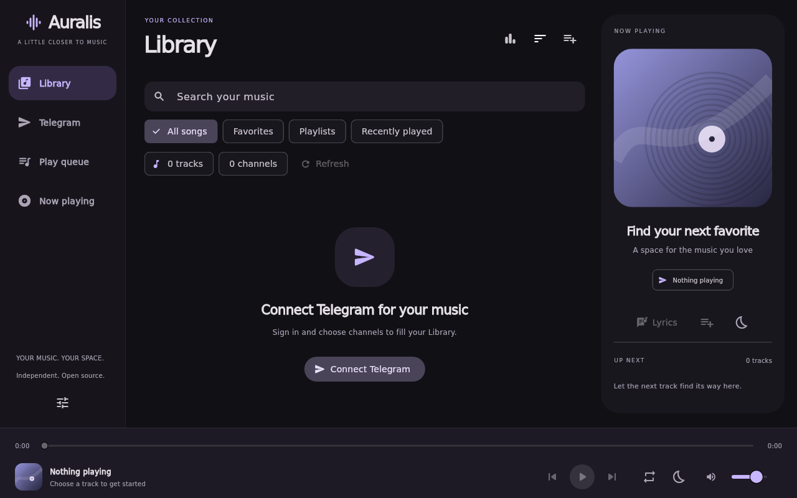

# Auralis — Windows x64 music player

An independently authored Flutter desktop player with a compact violet/charcoal interface, local music, a queue, and TDLib-based Telegram music browsing. Design references: [mpvRx](https://github.com/Riteshp2001/mpvRx); Telegram feature reference: [PixelPlayer](https://github.com/PixelPlayerHQ/PixelPlayer). This is a separate project, with no upstream application code, branding, screenshots, icons, or other assets copied.



## Milestone status

**Source milestone, not yet a verified installable Windows release.** Flutter analysis and automated tests ran on Windows 11 x64. Real TDLib initialization/shutdown, Windows DPAPI, libmpv decoding/playback/seeking, and playback through the loopback proxy were exercised separately. See [verification](docs/VERIFICATION.md) for exact results and limits.

The local executable build is blocked: Visual Studio C++ Build Tools are absent. Microsoft's signed installer exited with code 1602 after Windows elevation was unavailable/declined. No EXE, portable binary bundle, signed package, or installer is included. GitHub Actions built TDLib and the Flutter Windows app, then crashed in libmpv during smoke-test shutdown. A first callback-lifetime patch was insufficient: a subsequent trace still crashed in WASAPI device-monitor cleanup. The current vendored runtime adds Windows COM lifetime retention until complete native destruction and passes local native checks; this revision still needs a GitHub Actions run. See [shutdown fix](docs/NATIVE_SHUTDOWN_FIX.md).

Implemented:

- Responsive library, queue, and now-playing pages; persistent volume, local file references, and reduced-motion preference. Import multiple audio files; search loaded titles/artists. Original procedural artwork replaces missing album covers.
- Queue add, reorder, shuffle upcoming tracks, previous/next, repeat queue, play/pause, seek bar and volume. Ctrl+O imports files; media keys work while the app has keyboard focus. No global media-key registration.
- TDLib JSON bridge on a dedicated isolate; request correlation, timeouts, ordered updates, and graceful close. Phone, login code, and 2FA forms, plus email verification forms when Telegram requests them.
- Main and archived accessible chats, incremental chat loading, paginated audio-message browsing, and a separate audio-document filter. Browsing does not join channels or bypass permissions.
- Private loopback HTTP endpoint with an unpredictable capability URL; full/partial/suffix byte ranges, HEAD, download-prefix checks, buffered reads, range cancellation and stalled-download errors. Native seeking may be served from libmpv's buffer or trigger another TDLib range.
- Windows DPAPI-encrypted API credentials and random TDLib database encryption key. Codes, phone numbers, and 2FA passwords are not saved by Auralis. Native diagnostic logging is suppressed. Runtime data and native DLLs are ignored by Git.
- Automatic stable-release update checks, verified installer downloads, and user-confirmed install/restart, configured for [SiamTest/Auralis](https://github.com/SiamTest/Auralis). Settings includes a manual check and an automatic-check preference. See [update/release instructions](docs/UPDATES.md).
- Automated tests, Windows build workflow, versioned ZIP/source/installer packaging, and tag-triggered automatic GitHub Releases with checksum verification.

Not implemented or not verified:

- **Live account authentication and real Telegram music playback are unverified.** No API ID/hash, phone number, login code, or 2FA password was provided or used. Authorization tests use a fake TDLib transport; native TDLib was tested before account initialization. Buffered proxy tests simulate the TDLib file cache. They do not prove Telegram network behavior.
- Account creation, QR login, Premium-required verification, recovery flows, and automatic restart after logout are not implemented. The UI explains these states; use the official Telegram app where required. Restart Auralis after logout.
- No folder scanner, tag editor, album/artist index, album-art extraction, playlists on disk, persisted queue, lyrics, equalizer, crossfade, global shortcuts, system media controls, tray mode, installer signing, or forced background installation.
- No cache-size preference or automatic eviction policy yet. TDLib media cache files are plaintext in the user's application-data directory; the database key protects the TDLib database, not downloaded audio. Logout revokes the Telegram session; it does not promise secure deletion of cached media or API application credentials.
- No fresh-machine installer test, signing certificate, performance profiling, high-DPI hardware audit, screen-reader audit, or public distribution readiness claim. The bundled playback dependency resolves to an older native build; refresh and audit it before production use. See [notices](THIRD_PARTY_NOTICES.md).

## Dependencies and build

Use **Windows x64**, Flutter **3.47.1** / Dart **3.13.1**, Git, PowerShell **7.4+**, CMake, and **Visual Studio 2022** (or Build Tools 2022) with **Desktop development with C++**, the MSVC x64 toolset, and Windows SDK. Install these tools using their official installers, then check `flutter doctor -v`.

Pinned Dart dependencies and their transitive versions are in `pubspec.yaml` and `pubspec.lock`: Flutter, media_kit 1.2.6+auralis.2 (vendored MIT runtime with Windows COM/shutdown patches), media_kit_libs_windows_audio 1.0.9, ffi 2.2.0, file_selector 1.1.0, path 1.9.1, path_provider 2.1.6, package_info_plus 10.2.1, and crypto 3.0.7. TDLib is built separately; no third-party Dart Telegram wrapper is used. Keep `third_party/media_kit` in Git with the app; its patch and original license are included there.

From this directory:

```powershell
flutter pub get --enforce-lockfile
flutter analyze --fatal-infos
flutter test --reporter expanded
pwsh ./tool/build-tdlib.ps1 -Jobs 2
flutter build windows --release
dart run tool/native_smoke_repeat.dart `
  "$PWD/build/windows/x64/runner/Release/libmpv-2.dll" `
  "$PWD/native/tdjson.dll"
pwsh ./tool/package.ps1
```

TDLib's first build can take a long time and several GB of disk space. The script pins TDLib and vcpkg revisions, builds OpenSSL/zlib/gperf through vcpkg, and builds `tdjson.dll` with MSVC. Start with two parallel compiler jobs to limit memory use. It writes only its generated `.native-build/` tree, `native/` binaries, license texts, and build manifest. Neither upstream player is cloned or modified.

GitHub Actions caches the compiled TDLib DLLs, dependency DLLs, license files and build manifest immediately after a successful TDLib build. An exact cache hit skips native compilation. The key includes the Windows runner image version and hashes of the build script and workflow, so changing pinned revisions, build settings or the runner image starts a fresh build. The first run, an expired/evicted cache or a changed key still requires compilation. See [cache details](docs/UPDATES.md#tdlib-build-cache).

Run the app with `flutter run -d windows` after native setup, or launch `build/windows/x64/runner/Release/auralis.exe`. Keep **the entire Release directory** together. The executable depends on Flutter's DLL/data files, `libmpv-2.dll`, and `native/tdjson.dll` plus its dependent DLLs. End-user machines also need the Microsoft Visual C++ 2015–2022 x64 runtime. The optional installer currently assumes it is installed.

`pwsh ./tool/package.ps1 -Installer` additionally requires Inno Setup 6 and produces an unsigned per-user installer. It requests no administrator privileges and preserves application data during uninstall. Neither packaging mode has been tested with a built executable in this environment.

Packaging derives asset names and the installer version from `pubspec.yaml`. Commit the source first: the source ZIP is produced from Git `HEAD`. Release tags must match the version exactly (for example, `0.1.1+2` → `v0.1.1`). Packaging/tag validation has been tested with harmless fixture files; actual installer compilation/installation is still outstanding.

## Connect Telegram

1. Create your own application at [my.telegram.org](https://my.telegram.org) and obtain its API ID/hash. Do not use someone else's credentials or commit yours.
2. Open Telegram in Auralis and enter the application ID/hash locally. Enter your phone number with country code, the code delivered by Telegram, and your 2FA password if requested.
3. Browse your chats, select a channel/chat, then choose Music or Audio documents. Load older audio to continue pagination. Click a track to play the currently filtered list, or add individual tracks to the queue.

If a Telegram-specific delivery/verification step is unsupported, the app shows that state. Existing Telegram account membership/access rules apply. This app has no affiliation with Telegram, mpvRx, or PixelPlayer.

## Storage and architecture

Windows application support data is resolved by `path_provider`, using the runner's company/product metadata. The app creates `settings.json`, `credentials.dpapi`, `session.lock`, and `telegram/database` plus `telegram/cache` there. The session lock prevents two Auralis processes from opening the same account database. Settings contain local paths, never login secrets. DPAPI vaults cannot be copied to another Windows user/machine and decrypted there. Secrets necessarily exist in process memory while being used; Dart strings cannot guarantee memory zeroization.

- `lib/app.dart`: UI, responsive navigation, local imports, Telegram browsing/forms.
- `lib/player.dart`: native audio backend and queue controller.
- `lib/telegram/td_transport.dart`: native TDLib receiver isolate and correlated requests.
- `lib/telegram/telegram_service.dart`: authorization, chat updates and music search.
- `lib/telegram/stream_proxy.dart`: authenticated-by-capability loopback byte streaming.
- `lib/storage.dart`: Windows DPAPI vault and serialized atomic settings writes.
- `lib/updater.dart` / `lib/update_widgets.dart`: stable GitHub Release checks, checksum-verified downloads, update controls and graceful installer handoff.

Tests use generated audio and synthetic metadata only. Flutter UI previews are rendered test frames, not screenshots of a compiled Windows executable.

## GitHub Actions

Use this **project directory as the repository root** of [SiamTest/Auralis](https://github.com/SiamTest/Auralis), retaining `.github/workflows/windows.yml`. The workflow targets `windows-2022`, uses pinned action commits and Flutter 3.47.1, runs analysis/tests, builds TDLib from pinned source, builds Flutter Windows x64, runs native smoke tests, and uploads ZIP/installer/source/checksum artifacts. No Telegram secrets are needed. The current GitHub connection has READ permission only; this task inspected the first failed run but has not pushed the shutdown fix or started another run.

Pushing a matching stable `v*` version tag automatically publishes a GitHub Release after successful checks and server-side digest verification. Ordinary pushes/PRs create artifacts only. The app checks stable releases automatically, downloads after a user click, and requires confirmation to install/restart. Installers remain unsigned. See [UPDATES.md](docs/UPDATES.md) for setup, exact commands, security properties, and test limits. Complete the native corresponding-source/license audit before pushing a public release tag, and verify the first full CI run plus a clean-machine installation before calling it executable-tested.

## License

Original Auralis application code and original procedural artwork: **AGPL-3.0-or-later**, copyright 2026 Auralis contributors. See `LICENSE`. The Flutter-generated Windows host retains Flutter's BSD terms. Choosing AGPL does not mean mpvRx code was reused. Any future reuse of mpvRx code must preserve upstream notices and satisfy AGPL requirements.

PixelPlayer's current proprietary code and assets are **excluded**. Its older MIT contribution history is not used as an exception. Third-party libraries retain their licenses; see [upstream audit](docs/UPSTREAM_AUDIT.md) and [third-party notices](THIRD_PARTY_NOTICES.md). Include this source, dependency notices, and the required corresponding native source/build inputs when distributing a combined build; the present native dependency audit is not a clearance for public binary releases.
