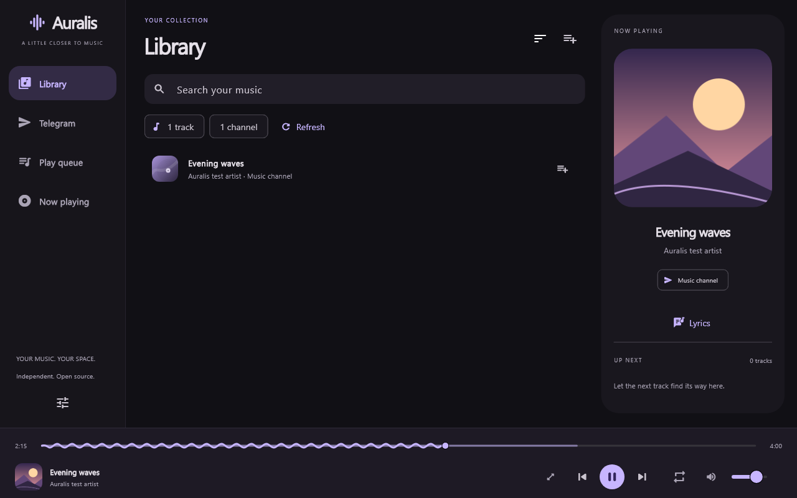
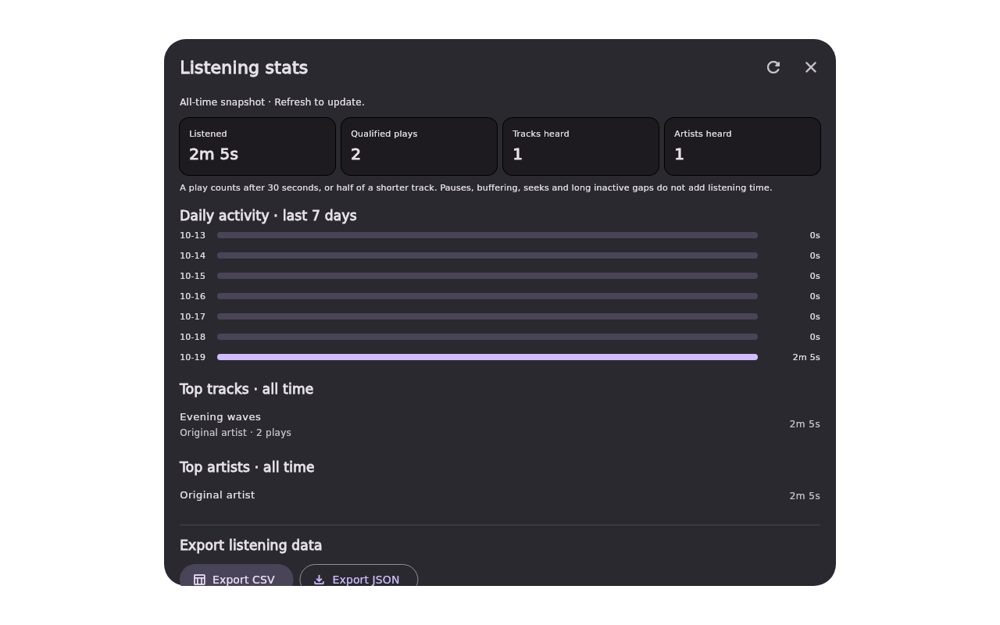
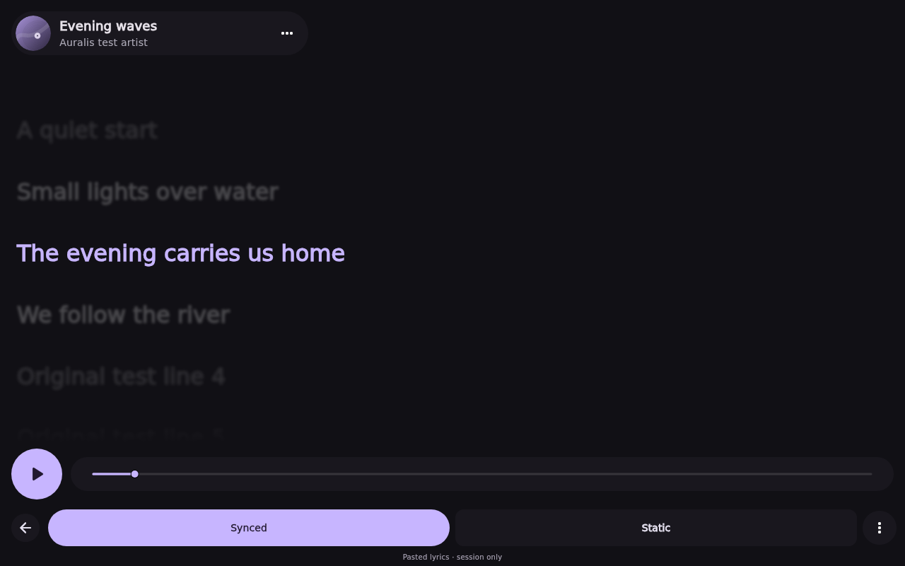
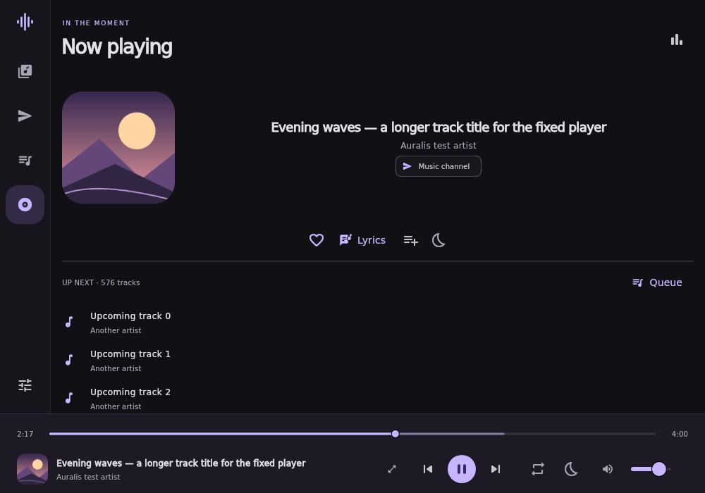
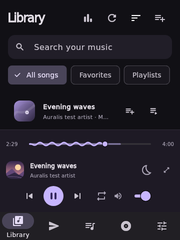
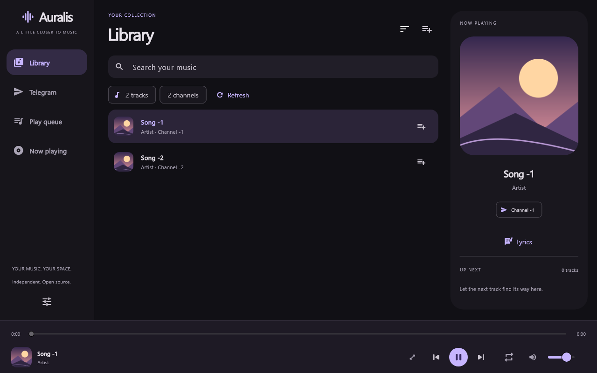

# Auralis — Android and Windows music player

An independently authored Flutter music player with a compact violet/charcoal interface, a Library combining music from selected Telegram channels, and a playback queue. Design references: [mpvRx](https://github.com/Riteshp2001/mpvRx); Telegram feature reference: [PixelPlayer](https://github.com/PixelPlayerHQ/PixelPlayer). This is a separate project, with no upstream application code, branding, screenshots, icons, or other assets copied.



## Milestone status

**CI-built Windows milestone; installation and live Telegram playback remain unverified.** The build job in [GitHub run 39264104723](https://github.com/SiamTest/Auralis/actions/runs/39264104723) passed analysis/tests, TDLib cache migration, Flutter Windows compilation, native smoke tests and installer packaging for v0.1.3. Publishing failed afterward; this source includes the repair plus embedded-cover support and Library sorting. See [verification](docs/VERIFICATION.md) for exact results and limits.

Current source version is **0.1.35+36**. This release fixes Now Playing overflow by measuring the hero after reserving Up Next, giving controls the full width in short windows, using wrapping icon actions in narrow panels, and letting artwork shrink before title/actions. The companion sidebar cover also yields space to its text and controls. The existing adaptive regression now checks that all five actions and the artwork stay inside the page. Flutter widget tests and static analysis must be rerun in CI; this editing environment has no Flutter SDK. This release fixes the lyrics cache argument type by passing `const ScrollCacheExtent.pixels(800)` to `scrollCacheExtent`, retaining the 800-pixel cache distance. This release replaces deprecated `ListView.builder(cacheExtent:)` with `scrollCacheExtent:` in the lyrics view, preserving the original 800-pixel cache distance and resolving the Flutter analyzer info reported on Windows and Linux. This update addresses responsive Flutter widget-test overflows by compacting the player dock on small windows, simplifying the wide companion Now Playing preview, bounding the main Now Playing artwork and action groups, and adjusting lyrics sidebar and text scaling. This update restores the missing lyrics playback controls and wave seek bar after the lyrics-page redesign, preserving the existing playback tests, and removes an unused Now Playing local variable. This update redesigns the Now Playing screen with a more mobile-inspired hero layout, stronger track hierarchy, cleaner action groups and a refreshed Up Next panel, while keeping the Library summary redesign, the improved bottom player bar, the immersive lyrics page redesign, the improved lyrics options popup and the Android ABI split workflow fix. This update restores the lyrics menu’s full embedded-lyrics action label without removing the rounded icon menu design, and adds a regression test for both menu entry points. It also reserves space for Up Next before sizing Now Playing artwork/details, so medium desktop windows keep visible queue previews without page scrolling. It also includes Gradle 8.14.3 to meet Flutter 3.47.1’s minimum and keeps the Android plugin on AGP 8.13.2. The Windows updater confirms its helper is ready before closing Auralis, waits for the actual GUI installer exit code, and enables installer diagnostics. The standalone native-smoke compilation fix remains included. LRC import remains available on Windows and Android. The Android workflow explicitly sets up SDK command-line tools before sdkmanager. Embedded lyrics and the app’s charcoal/violet lyrics theme remain included. Now Playing fits on one screen without page scrolling, with adaptive artwork/details, fixed song actions and a bounded Up Next preview. Open Queue for the full list. Android support and its separate **Android APK build** workflow remain included. The shared UI includes listening stats, CSV/JSON export, Backup & Restore, favorites, playlists, recent music, Play next, repeat one, sleep timers and the immersive lyrics page. Android adds a media playback foreground service, system/lock-screen controls, audio focus/interruption handling, Android Keystore encryption and system document export/restore. **Android APK compilation succeeded in GitHub Actions, but the resulting non-split APK failed strict ABI verification.** The Android workflow now builds a single-ABI split APK; rerun the workflow to validate its packaging and signing checks. Android device testing has not yet been verified. See [Android build instructions](docs/ANDROID.md), [verification](docs/VERIFICATION.md) and [Windows release instructions](docs/UPDATES.md).

Implemented:

- Original violet A/play app icon, with Windows taskbar/executable, Start menu and installer branding. Editable artwork is in [assets/branding](assets/branding/README.md). Version `0.1.1+2` carries the icon replacement; rebuild and reinstall to apply it. If a previously pinned shortcut retains Flutter's cached icon, unpin it and pin the newly installed Auralis executable again.
- Responsive Library, queue, and now-playing pages; persistent channel selections, volume and reduced-motion preference. Selected channels stay at the top of Telegram, with selected and unselected groups each alphabetical; selection changes reorder the list immediately. Select one or more channels in Telegram, then search their combined Library by title, artist or channel. Use the sort button beside Library to order by newest/oldest Telegram post, title, artist or shortest duration. The rounded dark menu opens below the sort button and marks the selected option with a check and purple text. The choice persists between launches; changing it does not reorder the queue. Local-file importing/playback is removed; old local-path preferences are ignored without deleting audio files.
- Music covers in Library, queue, Now Playing and the player bar: Telegram thumbnails, tiny previews and embedded MP3/FLAC/M4A artwork. Channel photos appear beside selection. Artwork loads on demand at low priority with bounded requests; missing/failed images use original procedural artwork. No external artwork search is used. See [artwork limits](#telegram-artwork).
- Queue add, reorder, shuffle upcoming tracks, previous/next, repeat queue/one track, Play next, play/pause, seek bar and volume. Hover the speaker icon or volume slider and scroll up/down for ±5% volume, bounded to 0–100%. Dragging changes native playback immediately; releasing saves the final level, while wheel changes save directly. The tooltip shows the percentage and the slider has a Volume accessibility label. Windows media keys work while the app has keyboard focus. Android exposes media-session notification, lock-screen and headset controls, including background playback.
- TDLib JSON bridge on a dedicated isolate; request correlation, timeouts, ordered updates, and graceful close. Phone, login code, and 2FA forms, plus email verification forms when Telegram requests them.
- Main and archived accessible channels only, with selection checkboxes. The Library automatically follows every older audio/document page from each selected channel, ignores non-audio documents, deduplicates messages and shows progress/partial errors. Changing selection or signing out invalidates pending results. Private chats, bots, basic groups and non-channel supergroups are excluded, including after title/photo updates. Browsing does not join channels or bypass permissions.
- Private loopback HTTP endpoint with an unpredictable capability URL; full/partial/suffix byte ranges, HEAD, download-prefix checks, buffered reads, range cancellation and stalled-download errors. Native seeking may be served from libmpv's buffer or trigger another TDLib range.
- Windows DPAPI-encrypted API credentials and random TDLib database encryption key. Codes, phone numbers, and 2FA passwords are not saved by Auralis. Native diagnostic logging is suppressed. Runtime data and native DLLs are ignored by Git.
- Automatic stable-release update checks, verified installer downloads, and user-confirmed install/restart, configured for [SiamTest/Auralis](https://github.com/SiamTest/Auralis). Settings includes a manual check and an automatic-check preference. The updater finishes audio/Telegram cleanup before requesting Windows exit, avoiding the premature cancel acknowledgement that stopped the helper in v0.1.3. Existing affected installs need one manual update; see [update/release instructions](docs/UPDATES.md).
- Automated tests, Windows build workflow, versioned ZIP/source/installer packaging, and automatic stable GitHub Releases from successful `main` builds or matching version tags, with checksum verification.

Not implemented or not verified:

- **Live account authentication and real Telegram music playback are unverified.** No API ID/hash, phone number, login code, or 2FA password was provided or used. Authorization tests use a fake TDLib transport; native TDLib was tested before account initialization. Buffered proxy tests simulate the TDLib file cache. They do not prove Telegram network behavior.
- Account creation, QR login, Premium-required verification and recovery flows are not implemented. The UI explains these states; use the official Telegram app where required. Signing out and starting another sign-in no longer requires an Auralis restart.
- No folder scanner, tag editor, album/artist index, persisted queue, equalizer, crossfade, global shortcuts, system media controls, tray mode, installer signing, or forced background installation.
- No cache-size preference or automatic eviction policy yet. TDLib media cache files are plaintext in the user's application-data directory; the database key protects the TDLib database, not downloaded audio. Successful logout forgets the saved API ID/hash and revokes the Telegram session. It does not promise secure disk erasure of cached media, old encrypted file contents or backups.
- No fresh-machine installer test, signing certificate, performance profiling, high-DPI hardware audit, screen-reader audit, or public distribution readiness claim. The bundled playback dependency resolves to an older native build; refresh and audit it before production use. See [notices](THIRD_PARTY_NOTICES.md).

## Logout and another account

Use **Settings → Sign out of Telegram**. Playback stops and the queue clears. When Telegram accepts logout, Auralis removes the API ID/hash from its encrypted vault and clears selected channels. The sign-in page shows progress until TDLib reports its closed state, then displays blank API ID/hash fields. Enter the details to start a fresh client, followed by the usual phone/code/2FA steps. The playback proxy follows the new client rather than keeping a closed connection. A normal app restart while signed in still retains your API configuration/session; explicit logout is what forgets it.

The database encryption key is retained, and Auralis does not recursively delete application-data folders. TDLib handles its own [logout cleanup](https://core.telegram.org/tdlib/docs/classtd_1_1td__api_1_1log_out.html). If Telegram rejects logout, the existing API configuration and channel selection stay intact and an error is shown. A failure to clear the credential vault is reported; entering new API details overwrites the saved configuration once storage is writable. Live switching between two real accounts and installation remain unverified.

## Favorites, playlists and recent music

Use the **All songs**, **Favorites**, **Playlists** and **Recently played** chips in Library. Track actions use the playlist/play icon beside the existing queue-add button: favorite/unfavorite, Play next, or Add to playlist. Now Playing also has a favorite button and Add to playlist shortcut. Favorites persist locally. Recent music records the last 100 unique successfully opened tracks, newest first; Clear history removes those references.

Create a playlist in Library → Playlists or while adding a track. Open a playlist and click a track to play its saved order. Rename and Delete are explicit buttons; track actions inside a playlist can remove that entry. Duplicate entries are ignored. Names are trimmed, case-insensitively unique and limited to 60 characters. There are limits of 100 playlists, 5000 tracks per playlist and 10000 favorites. Saved playlists keep their order; Library sort does not reorder them or Recent music. Delete removes the playlist only, never the Telegram files.

These are local collections, retained across sign-out and app restarts. They store message IDs and playlist names rather than native file IDs, artwork, credentials or audio copies. A saved track is playable only when its source channel is selected and its message appears in the loaded Library. Missing/inaccessible messages stay referenced but are not playable; choose the appropriate channels and refresh. The loaded/saved count is visible in larger windows. No cloud playlist sync, downloaded playlist audio or queue restoration is implemented.

## Repeat and sleep timer

The repeat button cycles **Off → Queue → One track → Off** and remembers the choice. Repeat one restarts a completed track; pressing Next still advances manually. Play next inserts immediately after the current queue entry without interrupting playback or changing which duplicate entry is active.

Open the moon icon in Now Playing or the playback bar. Choose **15, 30, 45, 60 or 90 minutes**, or **End of current track**. The active icon is highlighted and the dialog shows the pause time. Cancel timer removes it. Expiry pauses playback without clearing the queue or resuming already paused audio. End-of-track sleep takes priority over repeat. Clearing the queue or shutting down cancels the timer; it is not restored after restart and cannot wake a sleeping/closed PC.

## Listening stats, export and backups

Open the chart icon in the player header or **Settings → Listening stats** for total listening time, qualified plays, tracks/artists heard, top ten tracks/artists by listening time and daily activity for the last seven local calendar days. Stats start with this version; earlier recent history is not estimated. A play qualifies after 30 seconds or half the track duration, whichever is shorter, once per playback session. Repeat/replay starts a new session. Time is sampled from actual playback advancement, bounded by elapsed active time; pauses, buffering, app seeks and gaps longer than five seconds are excluded. Captured stats labels are limited to 1000 characters. Snapshots refresh on demand. Data is saved about every 30 seconds of playback events and on pause, track changes, export and orderly shutdown; an abrupt crash may lose the latest unsaved samples.

**Export CSV** writes UTF-8 spreadsheet data with separate track/day rows, listening seconds and qualified play counts. **Export JSON** preserves the complete stats structure. These exports contain stats only; use **Create backup** for a restorable snapshot. Track and day rows are alternate aggregations of the same time, so do not sum them together. Track titles, artist names and channel names are included in exports/backups; choose where to save them.

Open **Settings → Backup & Restore** directly, or scroll below the stats exports. A backup includes listening stats, favorites, ordered playlists, recent music, channel selections and preferences. It excludes Telegram credentials/sessions, music files, artwork, lyrics, the queue and sleep timer. Existing sign-in and music files stay in place. Channel/message references still require access to the same account and channels.

**Restore backup** checks the format, schema, size (64 MiB maximum) and SHA-256 integrity before displaying a confirmation with counts. Restore replaces the saved local data and stops playback/clears the queue. The current data is saved first as `auralis-before-restore.json` beside the app settings. **Restore recovery copy** restores that snapshot using the same preview; each successful restore replaces the single recovery slot with the data it supersedes. Failed writes preserve the current settings. Backups are plain JSON, not encrypted. The integrity digest detects accidental damage, not a maliciously edited backup.



## Now Playing lyrics

Open **Now Playing → Lyrics**, or click Lyrics in the side panel. The song header keeps its cover/title/artist, the current line is large and highlighted, and surrounding lines fade into the background. Synced lyrics follow playback and support clicking a line to seek. Scroll with the mouse to read elsewhere; **Follow song** resumes tracking. Static mode displays selectable text without timestamps. The immersive lyrics page includes play/pause and wave seeking. Back returns to the normal player and volume controls. Reduced motion uses instant scrolling. Layouts and screenshots are tested at 1280×800 and 360×480.

Embedded lyrics are read automatically when opening this page: MP3 ID3v2.2–2.4 USLT/ULT, millisecond SYLT/SLT and custom LYRICS/UNSYNCEDLYRICS/SYNCEDLYRICS text frames; FLAC Vorbis comment fields with those names; M4A/MP4 ©lyr atoms (UTF-8/UTF-16). LRC timestamps inside text tags enable Synced mode; plain tags use Static mode. Cached/pasted lyrics take precedence. **Lyrics options → Read lyrics from music file** retries extraction. Metadata reads share the artwork reader’s 4 MiB total budget and 20-second TDLib deadline. While streaming, only already buffered ranges are read so metadata extraction cannot move the playback download. If a needed range is not buffered, retry once it is downloaded. Compressed/encrypted ID3 frames, MPEG-frame SYLT timestamps, Ogg/Opus/WMA tags and automatic sidecar discovery is not supported; use Import .lrc file to choose a sidecar manually. No music is uploaded to a lyrics service.

Press **Find lyrics** to request a matching song from [LRCLIB](https://lrclib.net/docs). This sends only the displayed song title, artist and duration, never Telegram credentials, channel names or message/file IDs. There is no background lookup for unrequested songs. Results and pasted lyrics are kept only in a bounded, 32-entry session cache. Missing metadata, unindexed songs, alternate recordings and incorrect provider timings may prevent a match. Loading, offline/error, no-result and instrumental states are handled; plain-only lyrics use Static mode.

Use **Import .lrc file** in the empty state or **Lyrics options → Import .lrc file** to attach a local lyrics file to the current song. Windows uses the native .lrc picker; Android uses the system document picker, which may show all file types so providers can expose .lrc files. UTF-8 (with or without BOM) and UTF-16 LE/BE with BOM are supported. Files are limited to 256 KiB and 2000 lyric entries. Existing LRC offsets, repeated timestamps and translations work as usual; plain text uses Static mode. Import overrides the current session’s lyrics, with no audio/tag modification or upload. Cancelled/invalid imports preserve the previous lyrics, and a selection made for a song that has changed is discarded. Imported lyrics are kept in the same bounded session cache, not in backups.

Use **Paste lyrics** for plain text or line-timed LRC. It supports fractional seconds, repeated timestamps, offset tags and simultaneous translation lines. Lyrics are limited to 256 KiB per field / 2000 timed entries, with HTTP responses capped at 512 KiB and a 20-second overall deadline. Only line synchronization is implemented: no word-level karaoke, automatic translation or permanent lyrics library. PixelPlayer is a design and feature reference; no code/assets or song lyrics from it are bundled. Screenshots use original synthetic text.



## Adaptive player and wave seek bar

The bottom seek line has an independently drawn traveling wave on its played portion. It animates only for an active, unbuffered track with a known duration, freezes when paused and uses a straight line with user/system reduced motion. The animation is decorative; it does not sample audio or claim to display the file's waveform/spectrum. The seek thumb, buffered segment, timestamps, mouse seeking and focused-slider keyboard controls remain available. A localized repaint boundary keeps the animation inside the seek control. Click the bottom cover/title/artist area to open the current Now Playing page; seeking and transport buttons retain their own actions.

The sizing follows the navigation pattern of the user's Yutaka project, independently implemented: below 900 logical pixels use bottom navigation; 900–1179 use an icon rail; 1180 and up show the expanded sidebar. The Now Playing side panel appears only at 1220+ width and 620+ height and scales within bounds. Below 600 width the bottom metadata and controls stack, keeping repeat and live volume accessible. Short windows use tighter headers/navigation and the full Now Playing cover scales with the available screen size. Library status labels are concise so the smallest toolbar fits.

Windows source now requests a 360×480 logical client minimum using DPI-aware frame conversion, and fits/centers the initial window within the monitor's work area. Those Win32 calls await a CI build; Flutter layouts are tested at 360×480, 520×560, 760×650, 900×480, 1000×700, 1280×800 and 1920×1080, plus 130% text. Test screenshots use generated metadata/original fixture artwork, not a live account. Actual hardware resizing, high-DPI multi-monitor behavior and animation performance remain unverified.

Now Playing reserves up to three Up Next rows before choosing artwork size and layout. Medium desktop windows place the cover beside song details so upcoming tracks remain visible. At very short heights where a preview cannot fit, the section says Queue and keeps the full Queue button available. The page itself does not scroll.





## Streaming audio quality

Telegram playback uses the original file ID from the selected message. The streaming proxy passes its file bytes unchanged to libmpv: no re-encoding, lossy conversion, bitrate cap or lower-quality fallback. Download priority, buffering and byte-range seeking affect when bytes arrive, not their encoded quality. A slow download buffers or reports a stalled-transfer error rather than switching to a lower-bitrate copy.

This preserves the quality of the file supplied in Telegram; it does not restore detail already absent from that source. Volume adjustment and the Windows/audio-device output path are separate from file transport. Bit-perfect DAC output or exclusive-mode playback is not implemented or verified. The regression test checks a complete multi-chunk stream's SHA-256 against its simulated original and checks seek ranges exactly; live-account playback remains unverified.

## Dependencies and build

Use **Windows x64**, Flutter **3.47.1** / Dart **3.13.1**, Git, PowerShell **7.4+**, CMake, and **Visual Studio 2022** (or Build Tools 2022) with **Desktop development with C++**, the MSVC x64 toolset, and Windows SDK. Install these tools using their official installers, then check `flutter doctor -v`.

Windows build requirements are listed above. Android uses its separate workflow; see [docs/ANDROID.md](docs/ANDROID.md).

Pinned Dart dependencies and their transitive versions are in `pubspec.yaml` and `pubspec.lock`: Flutter, media_kit 1.2.6+auralis.2 (vendored MIT runtime with Windows COM/shutdown patches), media_kit_libs_windows_audio 1.0.9, ffi 2.2.0, path 1.9.1, path_provider 2.1.6, package_info_plus 10.2.1, crypto 3.0.7, and file_selector 1.1.0 for desktop save/open dialogs, media_kit_libs_android_audio 1.3.8, audio_service 0.18.19 and audio_session 0.2.4. Android file export/restore uses the Storage Access Framework. TDLib is built separately; no third-party Dart Telegram wrapper is used. Keep `third_party/media_kit` in Git with the app; its patch and original license are included there.

From this directory:

```powershell
flutter pub get --enforce-lockfile
flutter analyze --fatal-infos
flutter test --reporter expanded
pwsh ./tool/build-tdlib.ps1 -Jobs 2
flutter build windows --release
dart run tool/native_smoke_repeat.dart `
  "$PWD/build/windows/x64/runner/Release/libmpv-2.dll" `
  "$PWD/native/tdjson.dll"
pwsh ./tool/package.ps1
```

TDLib's first build can take a long time and several GB of disk space. The script pins TDLib and vcpkg revisions, builds OpenSSL/zlib/gperf through vcpkg, and builds `tdjson.dll` with MSVC. Start with two parallel compiler jobs to limit memory use. It writes only its generated `.native-build/` tree, `native/` binaries, license texts, and build manifest. Neither upstream player is cloned or modified.

GitHub Actions caches the compiled TDLib DLLs, dependency DLLs, license files and build manifest immediately after a successful TDLib build or compatible legacy-cache restore. The stable key includes the Windows runner image version and native build-script hash; UI and release-workflow edits do not invalidate it. An audited migration can reuse the existing v1 cache from the same image with the exact unchanged builder, then save it under the stable v2 key. Changed native inputs/images and unavailable caches still require compilation. See [cache details](docs/UPDATES.md#tdlib-build-cache).

The workflow also retains Flutter SDK and locked Pub package caching, and now caches Windows/CMake intermediates (including the libmpv download), Flutter/Dart compilation data, and native hook output. Compatible builds warm-start from the previous source revision; source changes receive a new cache entry. Keys separate Windows runner image, Flutter SDK, dependency lock, Windows native sources and vendored runtime. The final Release bundle is excluded and rebuilt; analysis, tests, native smoke checks, packaging and asset verification always run. If compiled TDLib is unavailable, vcpkg downloads and ABI-checked binary packages (OpenSSL/zlib/gperf) can be reused. Native dependency caches are saved even if a later TDLib compilation fails. See [build cache coverage and limits](docs/UPDATES.md#additional-build-caches).

Run the app with `flutter run -d windows` after native setup, or launch `build/windows/x64/runner/Release/auralis.exe`. Keep **the entire Release directory** together. The executable depends on Flutter's DLL/data files, `libmpv-2.dll`, and `native/tdjson.dll` plus its dependent DLLs. End-user machines also need the Microsoft Visual C++ 2015–2022 x64 runtime. The optional installer currently assumes it is installed.

`pwsh ./tool/package.ps1 -Installer` additionally requires Inno Setup 6 and produces an unsigned per-user installer. It requests no administrator privileges and preserves application data during uninstall. Neither packaging mode has been tested with a built executable in this environment.

Packaging derives asset names and the installer version from `pubspec.yaml`. Commit the source first: the source ZIP is produced from Git `HEAD`. Release tags must match the version exactly (currently `0.1.11+12` → `v0.1.11`). Packaging/tag validation has been tested with harmless fixture files; the current revision's installer compilation/installation is still outstanding.

## Connect Telegram

1. Create your own application at [my.telegram.org](https://my.telegram.org) and obtain its API ID/hash. Do not use someone else's credentials or commit yours.
2. Open Telegram in Auralis and enter the application ID/hash locally. Enter your phone number with country code, the code delivered by Telegram, and your 2FA password if requested.
3. Check the channels you want to include, then choose Open Library. Their music appears together as older audio and audio-document pages load automatically. Use Load more in Telegram to discover more main/archived channels. Your selection is saved and loads again after sign-in on subsequent launches.
4. In Library, search by title, artist or channel. Click a track to play the filtered list, or add individual tracks to the queue. Use Refresh to scan again for new music, retry partial failures and retry missing artwork. Deselect a channel in Telegram to remove its tracks from Library; already queued/playing tracks stay in the queue until you remove/clear them. Large channels can take time or hit Telegram rate limits; progress and partial errors remain visible.

If a Telegram-specific delivery/verification step is unsupported, the app shows that state. Existing Telegram account membership/access rules apply. This app has no affiliation with Telegram, mpvRx, or PixelPlayer.

## Telegram artwork

Audio messages first try the largest supplied Telegram album-cover thumbnail/cover variant; audio documents try their thumbnail. Tiny Telegram previews are shown while larger artwork loads. If a thumbnail is absent or unavailable, Auralis reads embedded artwork from ID3v2.2/2.3/2.4 (MP3), FLAC PICTURE blocks and MP4/M4A covr metadata. This is independently authored Dart code with no extra native library or external artwork lookup. Channel avatars use the small channel photo and follow photo-change/removal updates.

Only displayed items request artwork. The reader requests metadata ranges rather than full songs, skips MP4 audio payloads to reach tail metadata, caps metadata at 4 MiB, and parses away from the UI isolate. At most two cover jobs run together; up to 64 cover results and 128 channel/thumbnail request results are retained. Image decode sizes are bounded to the display. Metadata download requests use TDLib priority 1 and deadlines. For a file registered with the playback proxy, cover extraction uses already buffered bytes only: it never changes that file's active download offset. File-progress updates allow missing covers to retry as playback fills the cache. Refresh retries failed artwork. Original music bytes are unchanged.

Files with no picture, unsupported embedded-art containers (including Ogg/Opus/WMA), metadata exceeding the limit, inaccessible ranges or invalid image data retain a preview or the generated placeholder. The implementation cannot invent a missing cover. A provided thumbnail may be lower resolution than embedded artwork. Downloaded images/media remain plaintext in TDLib's application-data cache. The screenshot below uses original geometric test artwork embedded in a generated MP3 with **no Telegram cover thumbnail**; it verifies rendering with a fake TDLib transport, not the user's live channels.



## Storage and architecture

Windows application support data is resolved by `path_provider`, using the runner's company/product metadata. The app creates `settings.json`, `credentials.dpapi`, `session.lock`, and `telegram/database` plus `telegram/cache` there. The session lock prevents two Auralis processes from opening the same account database. Settings contain selected channel IDs/titles and preferences, never login secrets. Old local-file references are ignored and removed on the next settings save; source files are untouched. Channel selection remains a preference after sign-out, but music is cleared until connected and channels are checked through TDLib before indexing. Track metadata is rebuilt after launch rather than stored as a second persistent database. DPAPI vaults cannot be copied to another Windows user/machine and decrypted there. Secrets necessarily exist in process memory while being used; Dart strings cannot guarantee memory zeroization.

- `lib/app.dart`: UI, responsive navigation, channel selection, Library, artwork and Telegram forms.
- `lib/player.dart`: native audio backend and queue controller.
- `lib/telegram/td_transport.dart`: native TDLib receiver isolate and correlated requests.
- `lib/telegram/telegram_service.dart`: authorization, chat updates and music search.
- `lib/telegram/embedded_cover.dart`: bounded ID3/FLAC/MP4 picture extraction from file ranges.
- `lib/telegram/channel_library.dart`: selected-channel persistence, merged music indexing, pagination, cancellation and partial errors.
- `lib/telegram/stream_proxy.dart`: authenticated-by-capability loopback byte streaming.
- `lib/storage.dart`: Windows DPAPI vault and serialized atomic settings writes.
- `lib/updater.dart` / `lib/update_widgets.dart`: stable GitHub Release checks, checksum-verified downloads, update controls and graceful installer handoff.

Tests use generated audio and synthetic metadata only. Flutter UI previews are rendered test frames, not screenshots of a compiled Windows executable.

## GitHub Actions

Use this **project directory as the repository root** of [SiamTest/Auralis](https://github.com/SiamTest/Auralis), retaining `.github/workflows/windows.yml`. The workflow targets `windows-2022`, uses pinned action commits and Flutter 3.47.1, runs analysis/tests, builds or restores TDLib, builds Flutter Windows x64, runs native smoke tests, and uploads ZIP/installer/source/checksum artifacts. No Telegram secrets are needed. The current connection has READ permission; this task inspected the successful build but has not pushed the publishing follow-up.

Successful `main` builds automatically create the `vMAJOR.MINOR.PATCH` tag at the tested commit and publish a **stable release**, explicitly not a prerelease, after server-side asset digest verification. Matching version-tag builds also publish. Other branches/PRs create artifacts only. Already published versions are immutable: bump `pubspec.yaml` to a new stable version for each later release. The app checks stable releases automatically, downloads after a user click, and requires confirmation to install/restart. Installers remain unsigned. See [UPDATES.md](docs/UPDATES.md) for setup, publishing rules and test limits. The native corresponding-source/license audit and clean-machine installation check remain outstanding; a stable-release flag is not a production-readiness claim.

## License

Original Auralis application code and original procedural artwork: **AGPL-3.0-or-later**, copyright 2026 Auralis contributors. See `LICENSE`. The Flutter-generated Windows host retains Flutter's BSD terms. Choosing AGPL does not mean mpvRx code was reused. Any future reuse of mpvRx code must preserve upstream notices and satisfy AGPL requirements.

PixelPlayer's current proprietary code and assets are **excluded**. Its older MIT contribution history is not used as an exception. Third-party libraries retain their licenses; see [upstream audit](docs/UPSTREAM_AUDIT.md) and [third-party notices](THIRD_PARTY_NOTICES.md). Include this source, dependency notices, and the required corresponding native source/build inputs when distributing a combined build; the present native dependency audit is not a clearance for public binary releases.
